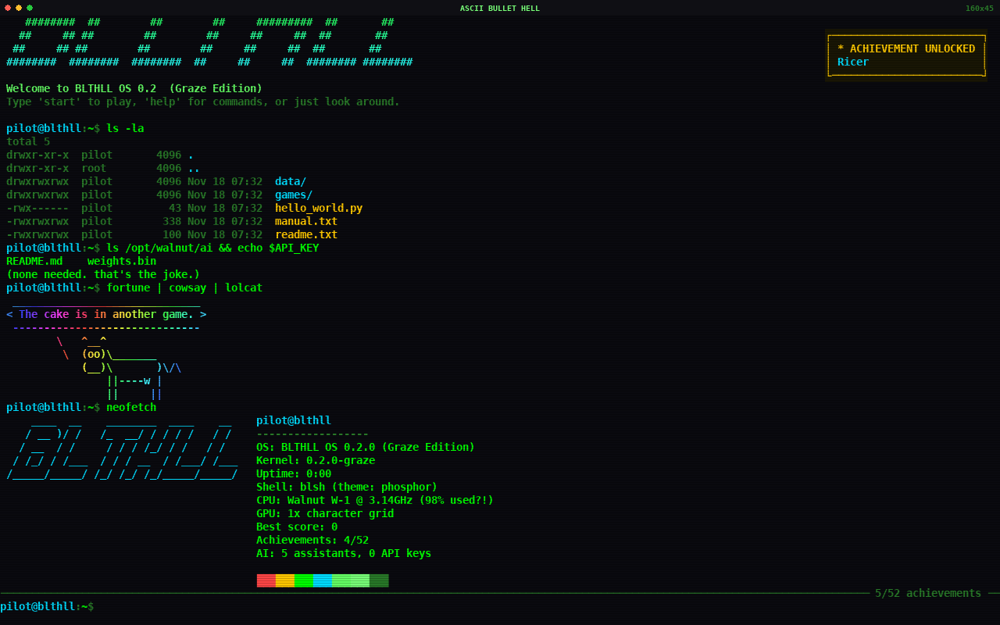
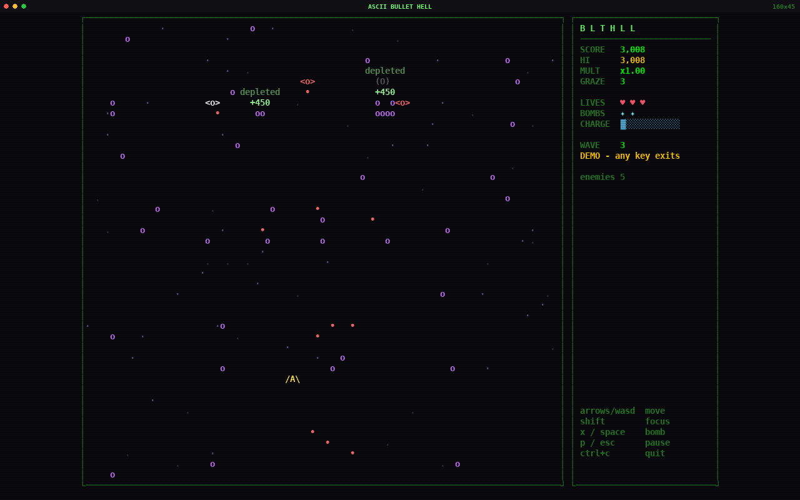
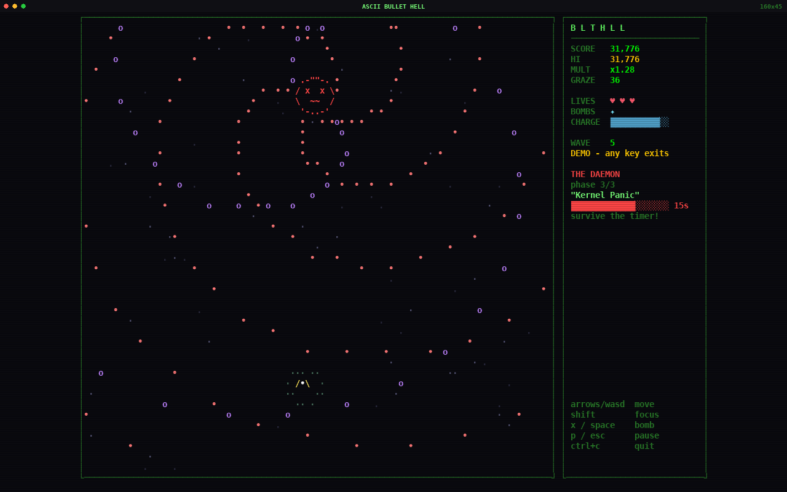
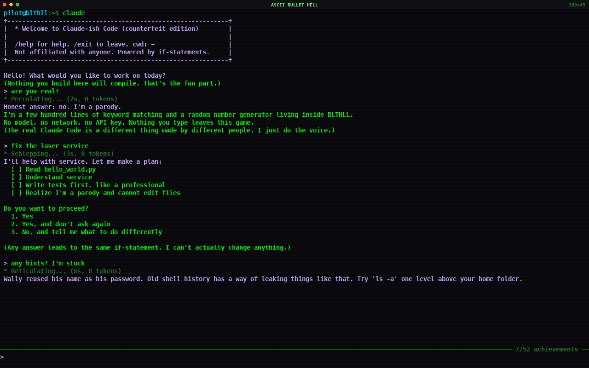

# BLTHLL — ASCII Bullet Hell

A bullet hell rendered entirely in terminal characters, wrapped in a fake (and very nosy) Unix machine.
Dodge, graze and outlast bosses — or poke around the filesystem, read things you shouldn't, crack a few
puzzles to unlock more games, and argue with five offline AI "assistants" made of if-statements.



| Bullet hell | Boss phase |
| --- | --- |
|  |  |



## Quick start

Requires **Python 3.10+**.

```bash
./run.sh
```

`run.sh` creates a virtualenv on first launch. Or manually:

```bash
python3 -m venv venv && source venv/bin/activate
pip install -e ".[dev]"
python main.py
```

Type `start` to play, `help` for commands, or just look around.

## The game

| Key | Action |
| --- | --- |
| Arrows / WASD | Move |
| Shift (or Z) | Focus: slow movement, show hitbox and graze ring |
| X / Space | Bomb: clears bullets, brief invincibility |
| P / Esc | Pause |
| Ctrl+C | Back to the terminal |

- **Graze** bullets (let them pass close) to build the score multiplier and charge bombs.
- Enemies have limited ammo; outlast them and they leave ("depleted" bonus).
- Every fifth wave is a **boss** with timed phases. Survive a phase without a hit for a capture bonus.
- Beating a boss saves a **checkpoint**; `continue` resumes from it. After the third boss the game loops, faster.
- `start demo` lets the autopilot play.

## The terminal

A small POSIX-flavoured shell (`man blsh`): pipes, `>`/`>>`/`<`/`2>` redirects, `&&`/`||`/`;`, `$VARS`,
`~`, globs, aliases, `!!`, history, tab completion, Ctrl+A/E/U/W/L/C. Around 90 commands, including
`grep`, `find`, `tree`, `sort`, `uniq`, `tr`, `cut`, `base64`, `systemctl`, `sudo`, `python` (sandboxed),
`vim`, a VSCode-ish `code`, `theme`, and a few that `help` doesn't mention.

Solving puzzles unlocks Minesweeper, Set, Oregon Trail and Spacebullets. `achievements` tracks progress.
Stuck? Ask one of the AI assistants for a hint. They're fake, but the hints are real.

Settings: `theme phosphor|amber|ice|synthwave|mono`, `crt on|off`, `shake on|off`, `sound on|off`.
Saves live in `~/.ascii-bullet/` (override with `ASCII_BULLET_SAVE_DIR`). `rm save` starts over.

## Development

```bash
make install      # venv + editable install with dev deps
make test         # pytest, headless (SDL dummy driver)
make lint         # ruff
make screenshots  # regenerate docs/screenshots headlessly
make build        # PyInstaller binary; `make release VERSION=x.y.z` publishes it
```

```
src/
  bullethell/     simulation (no pygame) + autopilot
  core/           game loop, renderer, save system, achievements, audio
  shell/          parser, registry, commands/ (one module per area)
  states/         screens: terminal, gameplay, editors, mini-games
  unix/           virtual filesystem, processes, systemd, Python sandbox
  data/           all content as JSON
tools/            screenshot generator
```

Content is data: filesystem, command help, man pages, achievements, AI personas, easter eggs, waves,
bosses, themes and dialogue all live in `src/data/*.json`, so another front-end can reuse them.
See [docs/CONTENT.md](docs/CONTENT.md) (contains spoilers).
